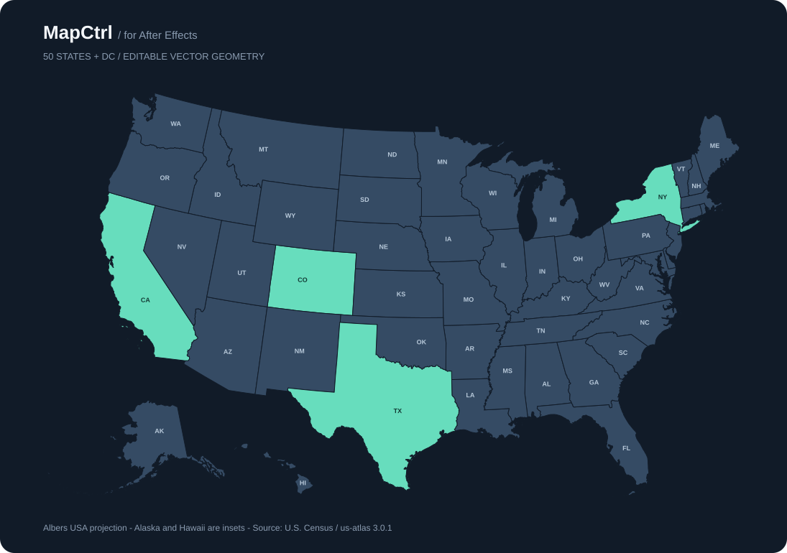

# MapCtrl for AE

Animate the United States, one state at a time. A dockable After Effects ScriptUI panel with icon actions, hover labels, editable vector states, map pins, and dashed waypoint routes.

[Download MapCtrl.jsx](https://github.com/EddyTheDesigner/MapCtrl-for-AE/releases/latest/download/MapCtrl.jsx) · [Testing checklist](docs/TESTING.md)



## Features

- **States:** 50 individual state shape layers plus Washington, DC. Select from the map or searchable list, apply a fill, or animate it with duration, easing, and stagger. Native state transforms remain editable.
- **Pins:** Choose a map location, optional label, size, and color. Add a pin and animate its entrance. Move or keyframe the native layer in AE.
- **Routes:** Arrange map locations and pin-linked waypoints in an ordered list. Control stroke width, dash, gap, reveal duration, and dash flow. Linked routes follow moved pins and survive layer renaming/reordering.
- **Map controller:** Move, scale, or rotate the whole map using its parent null. Alaska and Hawaii appear as insets.
- **Offline:** One JSX file with embedded geometry and drawn icons. No API key, runtime downloads, or extension installer.

## Install

Download `MapCtrl.jsx` from the release link above or use [`dist/MapCtrl.jsx`](dist/MapCtrl.jsx).

Copy it to your After Effects **Scripts/ScriptUI Panels** folder:

| Platform | Typical location |
| --- | --- |
| Windows | `C:\Program Files\Adobe\Adobe After Effects <version>\Support Files\Scripts\ScriptUI Panels\` |
| macOS | `/Applications/Adobe After Effects <version>/Scripts/ScriptUI Panels/` |

Restart AE and choose **Window > MapCtrl**. Drag the panel to dock it. For a floating panel without installation, choose **File > Scripts > Run Script File** and select `MapCtrl.jsx`.

The panel requires no file-write or network permission. See Adobe's [script installation documentation](https://helpx.adobe.com/ca/after-effects/desktop/automate-in-after-effects/automate-animation/scripts.html).

**Compatibility:** Designed for After Effects 2020 and later on Windows and macOS. This release has automated checks but has not been executed in AE on this workstation, which has no AE executable. Validate your version using the included [AE smoke script](tests/smoke-ae.jsx) and [manual checklist](docs/TESTING.md).

## Quick start

1. Open a composition and click the **create-map icon**. With no active comp, MapCtrl creates a 1920 × 1080, 30 fps, 10-second comp. Creating again reuses the existing map.
2. In **States**, select states and choose a color using the swatch or hex field. Apply a fill or animate to it from the playhead.
3. In **Pins**, click a map location, optionally enter a label, then add the pin. Its tip is its anchor point.
4. In **Routes**, click map locations or add existing pins to the waypoint list. Arrange the order, set the line style, and create the route.
5. Scrub your timeline and adjust native properties/keyframes. Hover over an action icon for its description.

Use native pin Position properties for precise placement after creation. The map is a projected illustration, not a latitude/longitude editor. Routes connect waypoints with straight segments; they are not road directions or geodesic paths. Pin sizes and line widths use map-space units and scale with the controller.

## Editing behavior

Actions target the **active composition** and use one undo group. Refresh after changing compositions or editing pins outside the panel. Keep MapCtrl metadata comments and named shape groups/effects intact; they identify its layers. Duplicate the whole composition when you need another map.

Animations start at the playhead. Keys inside the requested animation interval are replaced; keys outside it are preserved. Applying a static fill to an animated color adds a key at the playhead. Invalid timing and expression-driven properties are rejected before editing. If a native AE operation fails after adding layers, use Edit > Undo once to restore that action.

Pin-linked routes use Layer Control effects. If a linked pin is deleted, its route falls back to the location captured at creation. The miniature map shows base geography for placement and selection; it does not preview timeline animation or individual state transforms. Native animations continue working when the panel is closed.

## Build and test

Node.js 20 or later is needed only for development. No packages need installing.

```sh
npm run check
```

| Path | Purpose |
| --- | --- |
| `src/core.jsxinc` | AE layers, properties, expressions, animation |
| `src/ui.jsxinc` | ScriptUI layout, icon drawing, controls |
| `src/data.jsxinc` | Generated state polygons and interior anchors |
| `data/` | Pinned upstream geometry and attribution |
| `scripts/build-data.mjs` | Deterministic map conversion |
| `scripts/build.mjs` | Single-file JSX bundling |
| `dist/MapCtrl.jsx` | Installable panel |
| `tests/` | Automated checks and real-AE smoke script |

GitHub Actions rebuilds and checks generated files. Automated host mocks do not prove ScriptUI rendering or AE expression behavior; see [TESTING.md](docs/TESTING.md).

## Data and license

Geometry comes from [us-atlas](https://github.com/topojson/us-atlas), derived from the US Census Bureau's 2017 cartographic boundaries, using an Albers USA projection with Alaska/Hawaii insets. It is intended for motion graphics, not surveying or navigation.

MapCtrl code is MIT licensed. Upstream data provenance and license notices are retained in [THIRD_PARTY_NOTICES.md](THIRD_PARTY_NOTICES.md) and embedded in the distributed script.
